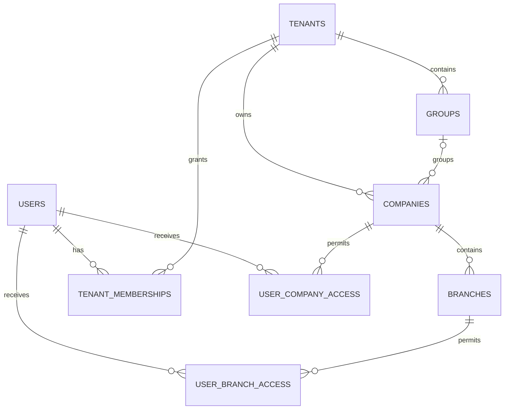
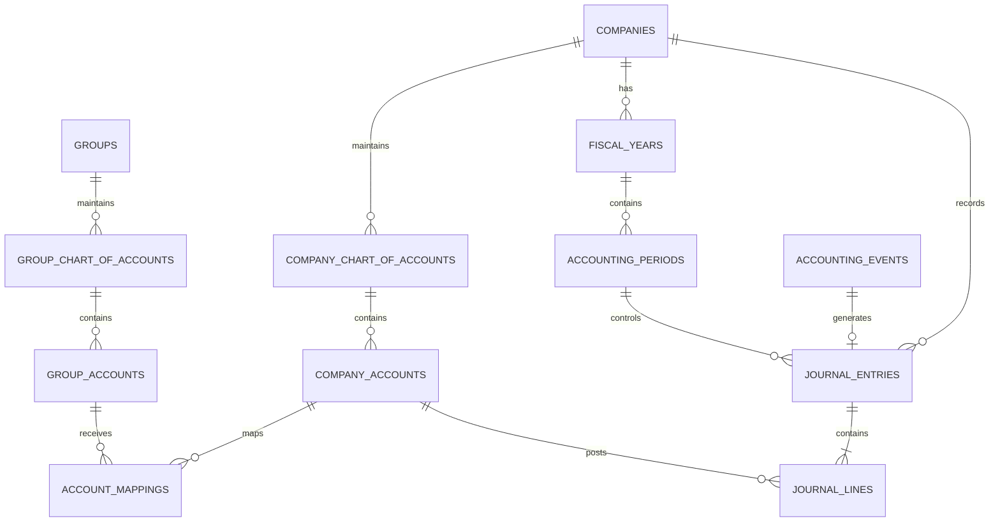

# Smart ERP – Database Entity Relationship Design (ERD)

**Version:** 0.1 – Core Database Design

## 1. Purpose

This document defines the initial Entity Relationship Diagram (ERD) and core database entities for Smart ERP.

The database will use PostgreSQL with a Shared Database and Shared Schema architecture.

The design must support:
- Multi-Tenant data isolation.
- Multiple groups, companies, and branches.
- Multi-currency accounting.
- Independent company accounting records.
- Group-level consolidation.
- Centralized accounting and posting.
- Modular business operations.
- Future expansion without major database redesign.

This is an initial logical design. Detailed physical table definitions, data types, indexes, constraints, and migrations will be documented separately.

## 2. Database Design Standards

### 2.1 Primary Keys
- Every entity must have a unique primary key.
- UUID is the preferred primary key type for business entities.
- Human-readable document numbers must be separate from database primary keys.

### 2.2 Tenant Isolation
- Every tenant-owned business record must include `tenant_id`.
- Tenant ownership must be enforced through database constraints and PostgreSQL Row-Level Security (RLS).
- Composite foreign keys must be used where necessary to prevent cross-tenant relationships.
- Tenant context must be established by trusted backend authentication and authorization logic.
- Database connection pooling must safely reset tenant context between requests.

### 2.3 Audit Fields
Important business tables should include:
- created_at
- created_by
- updated_at
- updated_by
- approved_at, where applicable
- approved_by, where applicable

Financial transactions must maintain additional posting and audit history.

### 2.4 Financial Data
- Use PostgreSQL NUMERIC for financial amounts.
- Never use floating-point data types for financial calculations.
- Store transaction currency and functional currency separately where required.
- Store exchange rates with appropriate precision.
- Preserve historical transaction values.

## 3. Organizational Structure Entities

### 3.1 Core Entities

| Entity | Purpose |
|---|---|
| tenants | Customers subscribing to Smart ERP |
| groups | Corporate groups belonging to a tenant |
| companies | Independent legal and accounting entities |
| branches | Operational branches belonging to companies |
| users | Global user identities |
| tenant_memberships | User access to tenants |
| user_company_access | User access to specific companies |
| user_branch_access | User access to specific branches |

### 3.2 Organizational Relationships

- One Tenant can have multiple Groups.
- One Tenant can have multiple Companies.
- One Group can have multiple Companies.
- A Company may belong to one Group or operate independently.
- One Company can have multiple Branches.
- One User can access multiple Tenants if authorized.
- One User can access multiple Companies and Branches with different permissions.

### 3.3 ERD

## 4. Security and Permission Entities

The database must support granular role-based access control.

Core entities:

- roles
- permissions
- role_permissions
- user_role_assignments
- access_scopes
- approval_workflows
- approval_steps
- approval_instances
- approval_actions
- audit_logs

Requirements:
- Roles may be defined at platform, tenant, group, company, or branch scope.
- Permissions must identify the module, resource, and permitted action.
- A user may have different roles in different companies.
- Access scopes must restrict access to authorized companies, branches, warehouses, or other resources.
- Approval actions must record the acting user, decision, timestamp, and comments.
- Audit logs must preserve important security and business changes.

## 5. Business Partner Entities

Business Partner data must be maintained centrally and reused across modules.

Core entities:

- business_partners
- business_partner_addresses
- business_partner_contacts
- customer_profiles
- supplier_profiles
- business_partner_bank_accounts
- business_partner_tax_registrations

Relationships:
- One Business Partner may act as a Customer, Supplier, or both.
- One Business Partner may have multiple addresses and contacts.
- Customer-specific settings must be stored separately from supplier-specific settings.
- Business Partners must be available only within their authorized tenant and company scope.

## 6. Accounting Foundation Entities

### 6.1 Chart of Accounts

Core entities:

- group_chart_of_accounts
- company_chart_of_accounts
- group_accounts
- company_accounts
- account_mappings
- account_categories

Relationships:
- One Group may have one unified Group Chart of Accounts.
- Each Company may maintain its own Company Chart of Accounts.
- Multiple Company Accounts may map to one Group Account.
- Account mappings must be validated for accounting compatibility.

### 6.2 Accounting Dimensions

Core entities:

- dimension_types
- dimension_values
- account_dimension_rules
- transaction_dimension_values

Supported dimensions include:
- Branch.
- Department.
- Cost Center.
- Project.
- Business Unit.
- Product Line.

Dimensions must be configurable and extensible.

### 6.3 Fiscal Calendar

Core entities:

- fiscal_years
- accounting_periods

Relationships:
- One Company may have multiple Fiscal Years.
- One Fiscal Year contains multiple Accounting Periods.
- Each journal must belong to the appropriate company and accounting period.
- Period status must control whether financial transactions can be posted.

## 7. General Ledger Entities

Core entities:

- journal_entries
- journal_lines
- accounting_events
- accounting_event_logs
- journal_attachments
- journal_reversals
- journal_approval_history

### 7.1 Journal Entry Structure

Journal Header:
- journal_id
- tenant_id
- company_id
- branch_id
- fiscal_year_id
- accounting_period_id
- journal_number
- transaction_date
- posting_date
- currency_code
- exchange_rate
- source_module
- source_document_type
- source_document_id
- journal_status

Journal Lines:
- journal_line_id
- journal_id
- account_id
- description
- debit_amount
- credit_amount
- transaction_currency_amount
- functional_currency_amount
- dimension references

### 7.2 Accounting Event Structure

The accounting_events entity must:
- Identify the originating business transaction.
- Maintain a unique event reference.
- Maintain an idempotency key to prevent duplicate processing.
- Track processing status and errors.
- Link successfully generated journal entries.
- Support controlled retries and reversals.

A unique source transaction and event type combination must be enforced according to the applicable business rules.

### 7.3 ERD

## 8. Sales and Accounts Receivable Entities

Core entities:

- sales_quotations
- sales_quotation_lines
- sales_orders
- sales_order_lines
- sales_deliveries
- sales_delivery_lines
- sales_invoices
- sales_invoice_lines
- sales_returns
- sales_return_lines
- ar_open_items
- customer_receipts
- customer_receipt_allocations
- customer_credit_notes
- customer_debit_notes

Important design rules:
- Sales Orders and Sales Invoices must have separate document lifecycles.
- A Sales Invoice must be the authoritative commercial invoice record.
- AR must maintain the financial receivable and settlement information without creating a duplicate invoice.
- Customer receipts must be separate from invoice allocations.
- One receipt may be allocated to multiple invoices.
- Multiple receipts may settle one invoice.
- Unallocated receipt balances must be supported.

## 9. Procurement and Accounts Payable Entities

Core entities:

- purchase_requisitions
- purchase_requisition_lines
- supplier_quotations
- supplier_quotation_lines
- purchase_orders
- purchase_order_lines
- goods_receipts
- goods_receipt_lines
- purchase_invoices
- purchase_invoice_lines
- purchase_returns
- purchase_return_lines
- ap_open_items
- supplier_payments
- supplier_payment_allocations
- supplier_credit_notes
- supplier_debit_notes

Important design rules:
- Purchase Orders, Goods Receipts, and Supplier Invoices must be separate documents.
- Supplier Invoice must be the authoritative supplier invoice record.
- AP must maintain the financial payable and settlement information without duplicating the supplier invoice.
- Support three-way matching between Purchase Order, Goods Receipt, and Supplier Invoice.
- Support partial receipts, partial invoices, and partial payments.
- Supplier advances must be recorded and settled separately.

## 10. Treasury Entities

Core entities:

- bank_accounts
- cash_accounts
- payment_requests
- payment_batches
- payment_vouchers
- receipt_vouchers
- bank_transactions
- bank_transfers
- cheques
- cheque_status_history
- bank_statements
- bank_statement_lines
- bank_reconciliations
- bank_reconciliation_matches
- loans
- loan_schedules
- letters_of_credit
- lc_utilizations

Treasury must own the actual cash and bank movements.

AR and AP must remain responsible for customer and supplier open items and invoice allocations.

## 11. Inventory Entities

Core entities:

- items
- item_categories
- units_of_measure
- item_uom_conversions
- warehouses
- warehouse_locations
- inventory_movements
- inventory_movement_lines
- inventory_reservations
- inventory_transfer_orders
- inventory_cost_layers
- inventory_valuation_records
- inventory_adjustments
- inventory_batches
- inventory_serial_numbers

Important design rules:
- Quantity movements and financial valuation must be traceable.
- Inventory movements must retain their source document references.
- Cost layers must support the configured valuation method.
- Inventory ownership must be distinguished from physical custody.
- Warehouse transfers must support dispatch and partial receipt.
- Inventory valuation must be reconcilable with the General Ledger.

## 12. Import Entities

Core entities:

- import_files
- import_shipments
- import_documents
- import_expenses
- landed_cost_allocations
- import_payments
- import_lc_links
- customs_clearances

Import records must reference the relevant Purchase Orders, supplier invoices, shipments, bank transactions, and inventory receipts.

Import Management must not create duplicate Purchase Orders, Supplier Invoices, or bank transactions.

## 13. Manufacturing Entities

Core entities:

- bills_of_materials
- bom_versions
- bom_components
- routings
- routing_operations
- work_centers
- production_orders
- production_order_operations
- material_issues
- material_returns
- production_completions
- production_scrap
- production_costs
- production_variances
- subcontracting_orders

Manufacturing must integrate with Inventory for material movements and finished goods receipts.

WIP and production costs must be traceable to their production orders.

## 14. Fixed Assets Entities

Core entities:

- asset_categories
- fixed_assets
- asset_components
- asset_acquisitions
- depreciation_books
- depreciation_runs
- asset_transfers
- asset_revaluations
- asset_impairments
- asset_disposals
- asset_maintenance_records
- lease_contracts
- lease_payment_schedules

Book depreciation and tax depreciation must be maintained separately.

Historical approved depreciation records must remain protected.

## 15. HR and Payroll Entities

Core entities:

- employees
- employee_contracts
- employee_documents
- employee_history
- departments
- positions
- attendance_records
- leave_requests
- payroll_periods
- payroll_runs
- payroll_results
- payroll_result_lines
- employee_advances
- employee_loans
- payroll_tax_rules
- payroll_insurance_rules

Sensitive employee and payroll information must have separate access controls.

Country-specific payroll rules must be effective-dated and version-controlled.

## 16. Cross-Module Relationship Rules

- Every business document must have one owning module.
- Related modules must reference the original document instead of creating duplicates.
- Accounting events must reference their source transactions.
- Journal entries must be generated through the Central Accounting Posting Engine.
- Payment allocations must reference AR/AP open items.
- Inventory movements must reference their originating documents.
- Manufacturing consumption must reference production orders.
- Fixed asset acquisitions must reference the originating purchase or capitalization documents.
- Payroll postings must reference the approved payroll run.

## 17. Data Integrity and Constraints

The physical database design must implement:

- Primary key constraints.
- Foreign key constraints.
- Unique constraints.
- Check constraints.
- Composite tenant-aware foreign keys where applicable.
- Required indexes.
- Appropriate numeric precision.
- Effective-date validation.
- Document numbering uniqueness.
- Duplicate event prevention.
- Transactional integrity.

Financial documents and posted accounting records must not be physically deleted.

## 18. Implementation Phases

The ERD must be implemented incrementally.

### Phase 1 – Platform and Organization
- Tenants.
- Groups.
- Companies.
- Branches.
- Users.
- Memberships.
- Roles and permissions.

### Phase 2 – Accounting Foundation
- Chart of Accounts.
- Accounting Dimensions.
- Fiscal Years.
- Accounting Periods.
- Journal Entries.
- Journal Lines.
- Accounting Events.
- Accounting Posting Engine.

### Phase 3 – Business Partner and Financial Subledgers
- Business Partners.
- Customer Profiles.
- Supplier Profiles.
- AR Open Items.
- AP Open Items.
- Receipts and Payments.
- Payment Allocations.

### Phase 4 – Operational Modules
- Sales.
- Procurement.
- Inventory.
- Treasury.
- Import Management.

### Phase 5 – Advanced Modules
- Manufacturing.
- Fixed Assets.
- HR and Payroll.
- Consolidation.
- Budgeting and Reporting.

## 19. Next Design Deliverables

After approval of this logical ERD, the following documents must be prepared:

1. DATABASE-DATA-DICTIONARY.md
2. DATABASE-CONSTRAINTS.md
3. DATABASE-INDEXING-STRATEGY.md
4. DATABASE-SECURITY-RLS.md
5. DATABASE-MIGRATION-PLAN.md

The physical database schema must be reviewed before implementation.
